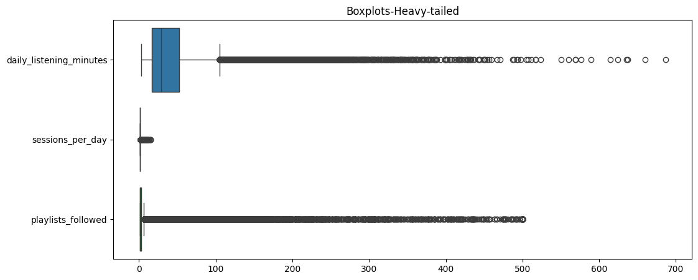
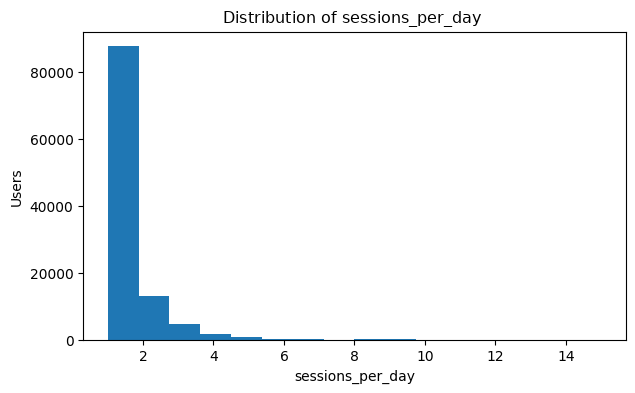
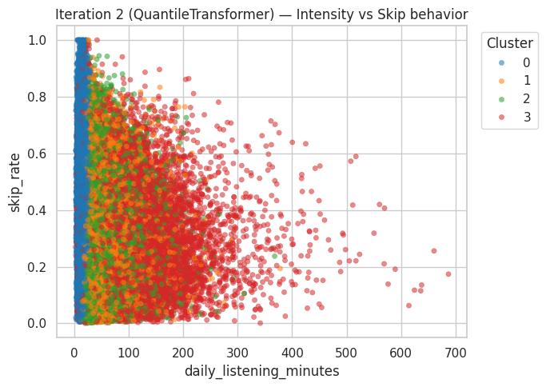
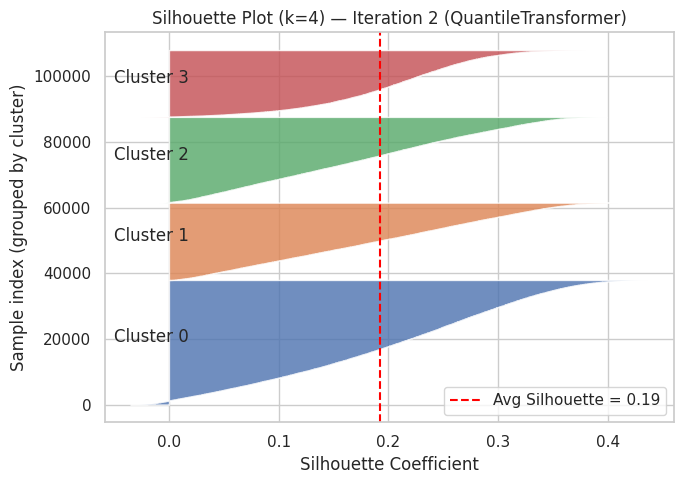

# Spotify User Segmentation

Clustering 108,000 Spotify users into behavioral segments using KMeans and Gaussian Mixture Models, and comparing how different feature scaling and transformation methods change the result.

## Overview

Understanding how people use a streaming service helps product, marketing and retention teams. This project groups users by how they listen (how much, how often, how consistently, and how they react to content and ads) rather than by who they are, and then checks whether the groups differ demographically.

## Dataset

Two Databricks tables, joined on user_id:

| Table | Shape | Contents |
|---|---|---|
| spotify_user_behavior | 108,000 x 26 | Listening, engagement and audio-taste features |
| spotify_user_demo | 108,000 x 6 | age, country, city_tier, device_type, subscription_tenure_months |

Data checks: 108,000 unique users in each table, no duplicates, no users missing from either table. The data is not included in this repository.

## Approach

1. Data audit: shape, duplicates, overlap, fill rates, range validation, skewness and distribution plots.
2. Feature selection: 7 behavioral features covering distinct axes:
   - daily_listening_minutes (intensity)
   - sessions_per_day (frequency)
   - days_active_last_30 (consistency)
   - avg_session_minutes (depth)
   - skip_rate (content friction)
   - liked_songs_pct (positive engagement)
   - ads_skipped_pct (ad friction)
3. Modeling with k = 4 (chosen for business interpretability):
   - KMeans: unscaled, StandardScaler, MinMaxScaler, RobustScaler, PowerTransformer (Yeo-Johnson), QuantileTransformer
   - Gaussian Mixture Models on Yeo-Johnson data: diagonal, full and tied covariance
4. Evaluation with average silhouette score and silhouette plots, with clusters interpreted in the original feature units.
5. Profiling: cluster sizes, feature means, and demographic breakdowns per cluster.

## Results

| Method | Silhouette |
|---|---|
| KMeans, unscaled | 0.515 |
| KMeans + StandardScaler | 0.152 |
| KMeans + MinMaxScaler | 0.180 |
| KMeans + RobustScaler | 0.160 |
| KMeans + PowerTransformer | 0.166 |
| KMeans + QuantileTransformer | 0.193 |
| GMM (diag) | 0.113 |
| GMM (full) | 0.114 |
| GMM (tied) | 0.154 |

Key takeaways:
- The unscaled score of 0.515 is inflated: features with large numeric ranges (daily_listening_minutes, avg_session_minutes) dominate the distance calculation, so it mostly reflects scale, not real structure.
- Among scaled approaches, QuantileTransformer + KMeans scored highest (0.193), followed by MinMaxScaler (0.180).
- Separation is weak across all methods (silhouette below 0.2), suggesting behavior forms a continuum rather than sharply separated groups.
- Most users have exactly one session per day, so three of the four quantile clusters are separated mainly by listening time, days active and ad skipping.

### Key charts

<table>
  <tr>
    <td align="center"> Skewed features (EDA)</td>
    <td align="center"> Most users have 1 session per day</td>
  </tr>
  <tr>
    <td align="center"> Clusters: listening intensity vs skip rate</td>
    <td align="center"> Silhouette plot, QuantileTransformer + KMeans (0.193)</td>
  </tr>
</table>

### Cluster profile (QuantileTransformer + KMeans, original units)

| Cluster | Users | Daily minutes | Sessions/day | Days active (30d) | Avg session (min) | Skip rate | Liked songs % | Ads skipped % |
|---|---|---|---|---|---|---|---|---|
| 0 | 37,952 | 15.3 | 1.00 | 20.4 | 15.2 | 0.392 | 0.257 | 0.494 |
| 1 | 23,557 | 48.1 | 1.00 | 26.1 | 48.1 | 0.292 | 0.357 | 0.514 |
| 2 | 26,125 | 47.7 | 1.00 | 17.4 | 47.7 | 0.277 | 0.255 | 0.624 |
| 3 | 20,366 | 77.8 | 2.63 | 21.7 | 29.2 | 0.304 | 0.298 | 0.568 |

For the full charts and code, open the [notebooks](notebooks/) folder, for example [07_kmeans_quantile_transformer.ipynb](notebooks/07_kmeans_quantile_transformer.ipynb).

## Limitations

- Silhouette scores are computed in each method's own transformed space, so they are not strictly comparable.
- k = 4 was fixed rather than selected with elbow, silhouette sweeps or BIC.
- Scalers were fit on the full dataset (no train/test split).
- Only 7 of 25 behavior features were used; audio-taste features were not explored.
- The profiling notebook is a template and has not been run on the real cluster labels.

## Next steps

- Select k systematically (silhouette sweep, BIC/AIC for GMM).
- Add the audio-taste features (danceability, energy, valence, etc.) as a second segmentation.
- Handle the sessions_per_day skew (log transform or binning).
- Validate cluster stability across random seeds and subsamples.
- Name the personas and propose a retention or ad strategy per segment.

## Tech stack

Python, pandas, NumPy, scikit-learn, matplotlib, seaborn, Databricks (Spark).

## How to run

1. Clone the repo and install dependencies: `pip install -r requirements.txt`
2. Provide the two tables as CSV or Spark tables with the schema described above.
3. Run the notebooks in the notebooks folder in numeric order.

## Author

Mohammed Viquar Uddin
